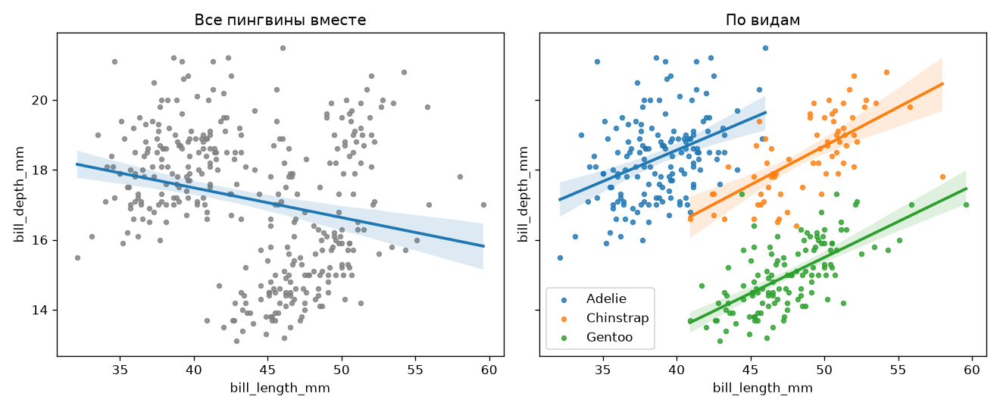

# Пингвины Палмера

Исследование морфологии трёх видов пингвинов (Adelie, Chinstrap, Gentoo).

## Вопросы
1. Как связаны длина и глубина клюва?
2. Различается ли масса самцов и самок у вида Adelie?
3. Можно ли определить вид пингвина только по размерам клюва?

## Данные
Horst, Hill, Gorman (2020), пакет palmerpenguins. 

## Результаты
1. **Парадокс Симпсона.** По всем птицам длина и глубина клюва связаны отрицательно (r ≈ −0.24),
   но внутри каждого вида — положительно (r от 0.39 до 0.65). Причина — различия между видами.
   
2. **Половой диморфизм Adelie.** Самцы тяжелее самок в среднем на ≈ 675 г
   (95% ДИ: 573–776 г; тест Уэлча, p < 10⁻²⁰).
3. **Классификация.** Логистическая регрессия по двум размерам клюва определяет вид
   с точностью 96% (5-кратная кросс-валидация) против 44% у константного предсказания.
   Чаще всего ошибается на Chinstrap.

## Как запустить
    conda create -n tools -c conda-forge conda-lock   # один раз
    conda activate tools
    conda-lock install -n palmer_penguins conda-lock.yml
    conda activate palmer_penguins
    pip install -e .
    python -m palmer_penguins.pipeline
    pytest
Затем открыть блокноты из папки notebooks/ по порядку.

## Автоматические проверки

При каждом push в `main`, на каждый pull request и раз в неделю по расписанию
GitHub Actions на чистой машине выполняет ([workflow](.github/workflows/tests.yml)):

| Проверка | Инструмент | Что гарантирует |
|---|---|---|
| Окружение | micromamba + `conda-lock.yml` | точные версии всех пакетов, как у автора |
| Стиль и типичные ошибки | [ruff](https://github.com/astral-sh/ruff): `ruff check`, `ruff format --check` | код без замечаний линтера и единообразно отформатирован |
| Юнит-тесты | `pytest` | очистка данных работает на контрольных примерах |
| Конвейер данных | `python -m palmer_penguins.pipeline` | данные скачиваются и очищаются с нуля; после очистки ровно 342 строки |
| Блокноты | `jupyter nbconvert --execute` | все блокноты выполняются сверху вниз в свежем ядре |

Еженедельный запуск нужен, чтобы вовремя заметить изменения во внешнем источнике данных.

### Проверить локально

    conda activate palmer_penguins
    ruff check .
    ruff format --check .
    pytest

Настройки ruff — в `pyproject.toml` (раздел `[tool.ruff]`).